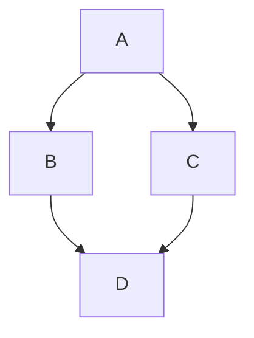
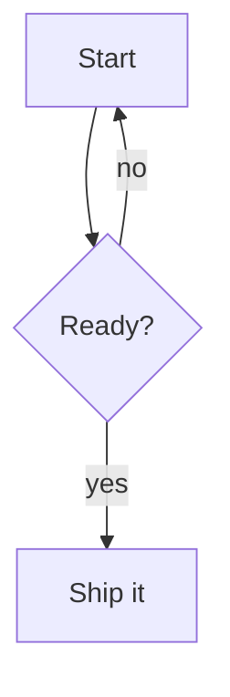

### intro
À partir du brief REDTAPE.FUN (plateforme de gamification des démarches administratives), rédigez une note de cadrage : les questions essentielles à poser avant de démarrer, un périmètre MVP priorisé, les risques majeurs du projet et votre compréhension de la vision produit. Livrable attendu : un document structuré de 4 à 5 pages.

### récap pour moi-même

    - fonctionnalités :
    plateforme, démarches administratives, progression par niveaux. Points quand niveau atteint. Collaboratif d'aide entre citoyens (partage de réussite, plateforme d'entraide). Titres et badges acquis selon niveaux et collaboration.  Quêtes cachées et secondaires selon niveau atteint et défis temporaires.
    Assistant intelligent :  apprends les habitudes pour guidance personnalisée. Informe des délais, donne des conseils, propose de découper par étape la démarche.
    Partie collaborative : classement des utilisateurs, partage des niveaux atteints (proches ou commu), systèmes d'entraide entre citoyens.
    Personnalisation :  avatars, préférence d'interface, notifications, tableau de bord.
    
    - Sécurité : système d'authentification via FranceConnect, sécurisé (communication chiffréesà), respect normes gouvernementales, API et compatibilité des sytèmes administratifs existants, Synchronisation des données en temps réel, tracabilité des actions (qui, que, quoi, ou, quand). RGPD, RGS (sécurité système). 
    Protection des données : collection data minimale (pas l'age),  consentement pour l'utilisation data utilisateur (non précoché), droit à l'oubli (bdd).
    
    - Rendu visuel : RGAA niveau AA, quête avec objectif clairs, progression viseulle, étapes, récompenses et points lors d'achèvement, obtention de badge.
    Fonctionnalité supplémentaires : - Suggestions(présentation ludique d'un service avec un défi temporaire et une quête spéciale) pour découvertes des services. aide contextuelle, support. francais (évolution à prévoir)
    
    - spé tech :
    accessibilité RGAA (handi)
    architecture solide, découpage du système en plusieurs petites appli. communiquent entre elles via APIs. Front : Rect, ou vue.js, Serveur : node.js ou python.  BDD : PostgreSQL, Redis (données en cache). Containerisation : doceker, kubernetes pour synchro et orcherstration. 
    rendu : reponse front 3 sec, back : 200 millsec, requête http : 100 millsec.
    disponibilité 99,5%, sav ds 4h, sauvegarde : auto, journalière, conservées 30j.
    "role" : citoyens, agent administratif (droits spé lié à son service), prévoir un "multi-tenant" : plusieurs administration sur même plateforme (chacune son espace, données, configuration, ...).
    système de paiement (payer les démarches).
    control system : nb de co, santé, alertes, erreurs, surcharges, haking, hameconnage, attaque DoS.
    supporte surcharge de connexion simultanées.
    
    - contraintes et exigences : 
    Tous navigateur, mobile first (responsive). communication avec systèmes de l'administration existants, architecture prête pour la lourdeur de la charge, modulable (MS), évolutif (contrainte légale forte)
    budget : limité par phase, MVP. prévisionnel (couts fixes : serveur, hébergement, maitenance, support tech, et sur les évolutions).
    planning : sous 6 mois (version pilote), puis 6 mois tests.

    - utilisateurs, cibles :
    personnas : marie : utilisation normale, middle-age. jean-pierre : utilisation binaire, senior. amelie : fluente, young. fatima : aidante, débutante, middle-age. lucas : à l'aise, young.

    - analyse concurrencielle : 
    pratiquement pas de concurrence
    exemple en estonie :  programme de résence numérique qui permet de créer une entreprise estonnienne en ligne (avantage : modener, design, intuitif, par étapes, clair, communauté, intégration fonctionnelle / inconvenients : pour une seule cible, pas de récompense, un peu complexe).

    - analalyse statégique : 
    force : pratiquement aucune concurrence, expert en gamification, partenaire  avec l'adminstaration (contraintes comprises), intégration FranceConnect natif.
    faiblesse : equipe taille instable (entre 5-15 pers.), contraintes réglementaires fortes, resistance au changement fort (jamais eu de changement), bugdet limité.
    opportunités : modernisation numérique forte, attentes citoyennes fortes, soutient potilitique, potention d'expansion à l'europe si modèle efficace.
    nuances : changement politique imprevisibles, contraintes budgétaires, résistances des agens publices, evolution rapide technologiques (mise à jour constante).

    - positionnement concurrentiel :
    avantages : innovation (1er à le faire) , intégration (compatiblité native), expertise (connaissance approfondie du milieu), partenariat (relations établies avec adminstarations).
    statégie de différenciation : approche ludique (gaming), personnalisation (à tous niveaux selon l'utilisateur), progressivité (étapes de déploiement), communauté (dynamique d'engagement collectif).

    - recommandation stratégiques :
    6 mois : MVP avec fonctionnalités de base, groupes de testeur, intégration franceConnect, mesurer l'engagement initial, gamificiation légère, communauté simplifiée.
    12 mois : plateforme utilisable, gamification enrichie, communauté développée, optimisation des perfs et accessibilité, assistant intelligent effectif (s'adapte en fonction de l'utilisateur et de sa situation, de ses informations), déploiement possible pour d'autres adminstration.

    - evolution fututures :
    Pour les mois 13 à 24 : expansion (Déploiement national, intégration multi-administrations, optimisations de performance, et évolutions basées sur les retours). 
    Canaux possibles de déploiement : applis, bornes... ( fonctionnalités : notifications personnalisées selon utilisateurs et ses informations). déploiement de l'aspect communautaire : évènements, défis, mentorat, ...
    partenaires :  intégration des collectivités locales, associatif, services (si changement d'adresse, les fournisseurs des services de l'utilisateur sont avertis, etc. ...)

diagramme : extension mermaid
[Link](https://marketplace.visualstudio.com/items?itemName=MermaidChart.vscode-mermaid-chart)

> Blockquote
* List
* List
* List
1. One
2. Two
3. Three

`Inline code` with backticks 

____
